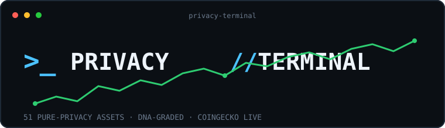

<div align="center">
  
</div>

# PRIVACY//TERMINAL

**A single-file research terminal for pure-privacy crypto assets.**

51 assets where **privacy is the protocol's core purpose** — no ZK-rollup infrastructure, no general-purpose L1s that merely flirt with privacy. Every row carries a hand-built **DNA profile**: what the cryptography actually hides, what you have to trust, the shape of the anonymity set, the security history and the regulatory posture.

**🔴 Live: [akaradje.github.io/privacy-terminal](https://akaradje.github.io/privacy-terminal/)** — one self-contained HTML file, no build step, no dependencies, works offline.

---

## What's inside

### 1. Pure-privacy dataset (51 assets)
Hand-classified into four families — the only inclusion rule is that privacy *is* the protocol, with a publicly verifiable mechanism:

| Family | Assets |
|---|---|
| Privacy Coins (currency-level privacy) | ZEC, XMR, GRIN, BEAM, MWC, FIRO, ARRR, DERO, ABEL, IRON, XTM, EPIC, DASH, DCR, BDX, ZANO, XVG, ZCL, ZER, PIVX, NAV, PART, YEC, XEL, ZEPH, NOCK |
| Privacy Protocols (layers on other chains) | AZTEC, RAIL, ZAMA, TORN, NIGHT, ALEO, XAN, UMBRA, DARK, ZKP, DUSK, CC, AZERO, VRSC |
| Network Privacy (metadata / IP layer) | NYM, HOPR, SESH, MYST, P2P, ANYONE |
| Confidential Compute (FHE · MPC · TEE) | SCRT, ROSE, PHA, MPC, OCT |

Everything else in CoinGecko's privacy categories — ZK rollups, general L1s, adjacent tooling — is **deliberately excluded** (200 assets cut) because it is not privacy by design.

### 2. DNA profiles (52, hand-curated from project documentation)
Click any row to open the dossier:

- **Gene strip** — what is hidden (sender / receiver / amount / state), each marked `FULL` (always) or `OPT` (opt-in); **mandatory?** **trustless?** (no trusted setup / TEE / committee)
- **primitive** — the actual cryptography (Halo 2, RingCT+CLSAG, MimbleWimble, TFHE, MPC, TEE, mixnet…)
- **trust assumption · anonymity set · audit · governance · security history · compliance · stage · event timeline**
- **Project dossier** — description, nine link channels (website / whitepaper / GitHub / X / Telegram / Discord / Reddit / forum / explorer), 7-day price sparkline, and dev activity pulled from the GitHub API (stars, forks, open issues, language, last commit, licence)

### 3. DNA Matrix
A gene-by-gene comparison table of all 51 assets with a **transparent, computed score**:

```
coverage (what is hidden) ÷ applicable max × 60  +  mandatory 15  +  trustless 15  +  network-wide anonymity set 10  =  100
```

The rubric is printed on the page. Scores measure **mechanism strength**, not value or investment merit. Notable outcomes: XMR / GRIN / EPIC / MWC / XTM = 100, AZTEC / ALEO / OCT = 90, ZEC = 75 (opt-in, pool-based), DASH / TORN = 45.

### 4. Terminal UX
Single view, sortable columns, `/`-to-focus search that reaches into the DNA text (`mimblewimble`, `sgx`, `ringct`, `trusted setup`, `ofac`), mcap and DNA-grade filters, `j/k` + `Enter` keyboard navigation, 7-day sparklines inline, and a **⟳ LIVE** button that re-fetches prices from CoinGecko in the browser.

## Data sources & method

| Layer | Source | Coverage |
|---|---|---|
| Price / mcap / volume / 1Y change | CoinGecko public API (`/coins/markets`, 8 privacy-related categories) — snapshot 2026-10-15 | 251 assets surveyed, 51 kept |
| Project dossier (description, links, genesis, algorithm) | CoinGecko `/coins/{id}` | 51/51 |
| Dev activity (stars/forks/issues/last commit/licence) | GitHub API (repo resolved from the CoinGecko link; org-level links resolved to the org's top-starred non-fork repo and labelled as such) | 48/51 |
| 7-day price history | CoinGecko `/market_chart?days=7` | 50/51 |
| DNA profiles, tiering, timelines | Hand-curated from project documentation and public security disclosures | 52 profiles + 13 timelines |

Market data carries its own timestamp; anything unverified is left blank rather than estimated. Three assets (ABEL, CC, DARK) have no confidently identifiable GitHub repo and are shown without dev stats.

## Rebuild

```bash
python data/fetch_detail.py     # refresh dossiers + sparklines from CoinGecko
python data/enrich_gh.py        # refresh GitHub dev stats
python build.py                 # template.html + app.js + data/*.json -> privacy-terminal.html
```

`privacy-terminal.html` is the deployable artefact — drop it on any static host.

## Colour convention

**Green = up, red = down** (international crypto standard). Non-price semantics (sanction/severity badges) use their own colours and are deliberately decoupled from the price convention.

## Limits

- Prices snapshot to the data timestamp; the LIVE button needs a browser with internet access.
- CoinGecko's free tier no longer serves community/developer data, so dev activity comes from GitHub directly.
- DNA profiles are summaries for screening, **not security audits** — read each project's own documentation before acting.
- One sparkline (DERO) is missing due to API rate limiting.

> **免责声明**：以上内容基于公开数据和量化分析，仅供参考，不构成投资建议。市场有风险，投资需谨慎。任何投资决策应结合个人风险承受能力、资金状况和投资目标独立判断，必要时咨询持牌专业机构。过往表现不预示未来收益。
